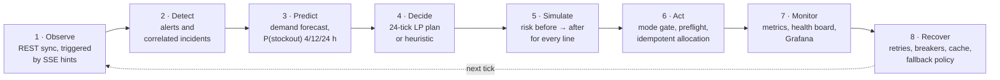
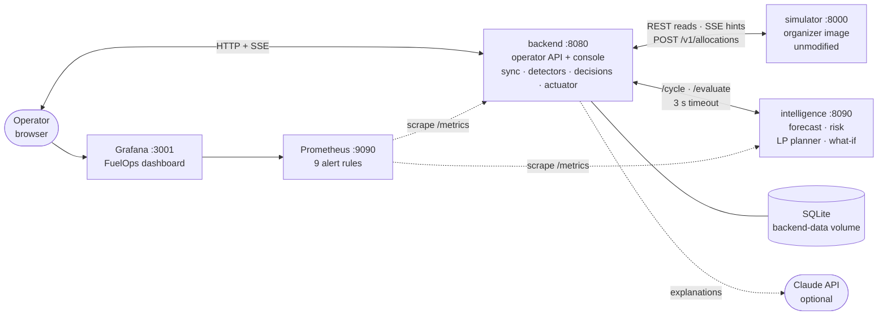
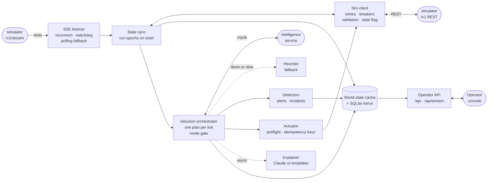
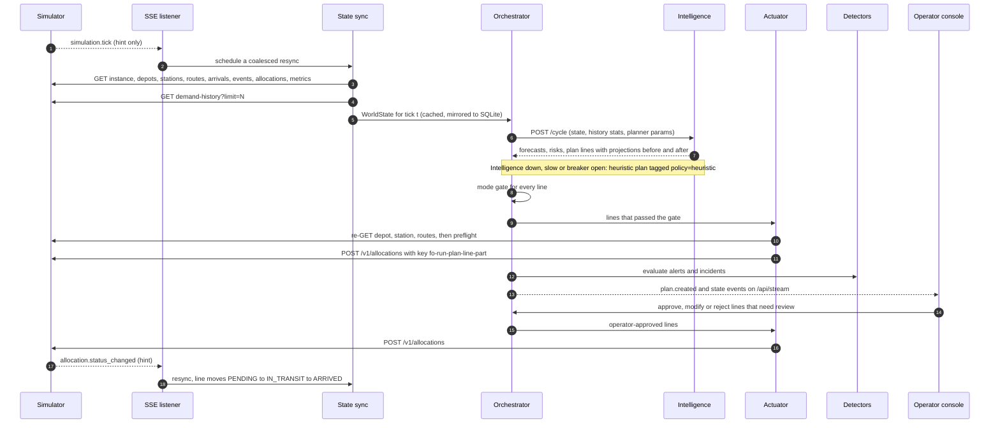
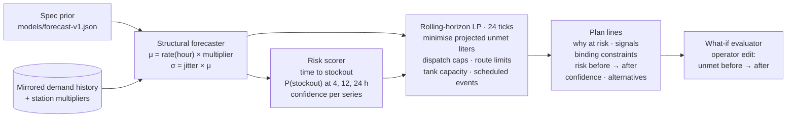
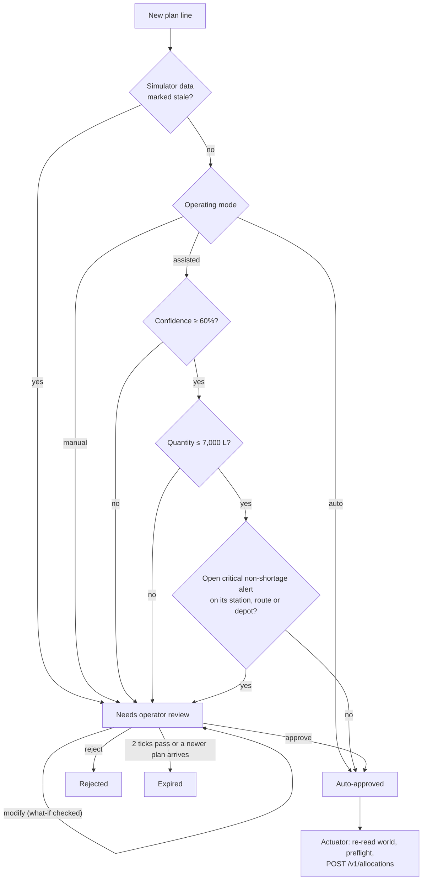
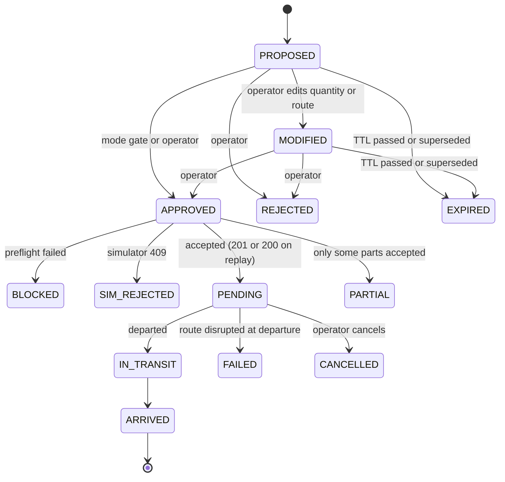
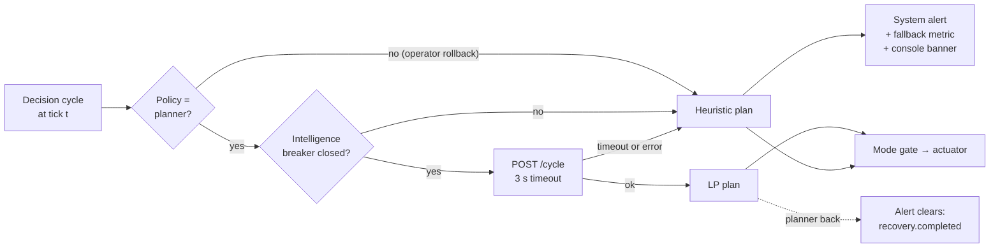
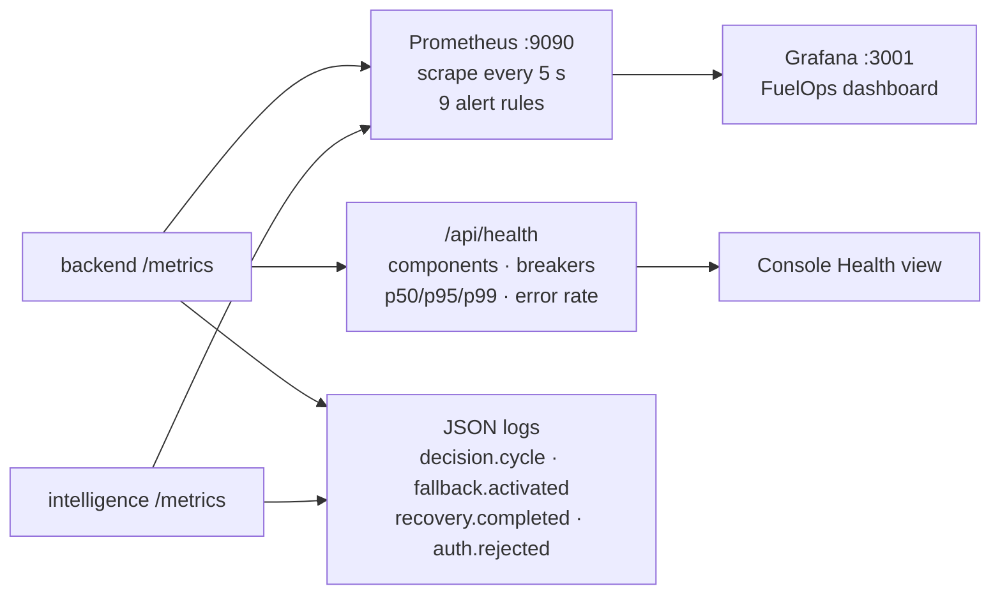
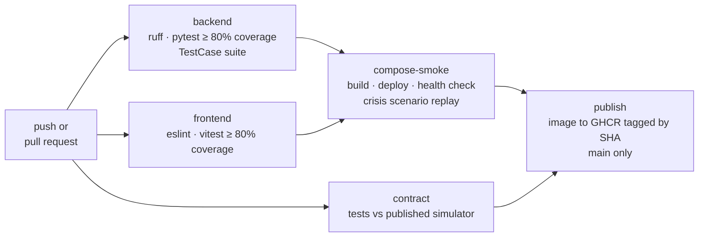

# FuelOps — Fuel Supply Intelligence & Resilience Platform

[](.github/workflows/ci.yml)

**BUP CSE Fest 2026 — Hackathon Finals.** FuelOps watches the organizer's **BUP Fuel Supply Simulator**, predicts
stockouts, plans fuel allocations with a linear program, keeps a human in the loop for consequential decisions, and
keeps working when its own components or the simulator API fail.

> **All data is SIMULATED.** FuelOps only ever talks to the organizer's simulator image. It never touches real fuel
> infrastructure, real purchases or real credentials.

## Contents

1. [Quick start](#1-quick-start)
2. [The operating loop](#2-the-operating-loop)
3. [Architecture](#3-architecture)
4. [How one tick flows through the system](#4-how-one-tick-flows-through-the-system)
5. [Intelligence: forecast → risk → plan](#5-intelligence-forecast--risk--plan)
6. [Human in the loop](#6-human-in-the-loop)
7. [Resilience: what happens when something breaks](#7-resilience-what-happens-when-something-breaks)
8. [Operator console](#8-operator-console)
9. [Observability and health](#9-observability-and-health)
10. [Evidence](#10-evidence)
11. [Tests and CI/CD](#11-tests-and-cicd)
12. [Configuration](#12-configuration)
13. [Rollback](#13-rollback)
14. [Security and guardrails](#14-security-and-guardrails)
15. [Data sources and assumptions](#15-data-sources-and-assumptions)
16. [Repository layout](#16-repository-layout)

---

## 1. Quick start

Requires Docker with Compose v2.24+. Nothing else on the host.

```bash
cp .env.example .env
# set OPERATOR_TOKEN in .env to a long random value, e.g.
#   python -c "import secrets; print(secrets.token_urlsafe(32))"
docker compose up -d --build
```

| What | URL |
|---|---|
| Operator console | http://localhost:8080 (sign in at `/login.html` with `OPERATOR_TOKEN` to act) |
| Backend API docs | http://localhost:8080/docs · metrics at `/metrics` |
| Intelligence API docs | http://localhost:8090/docs |
| Simulator (organizer image, unmodified) | http://localhost:8000/docs · dashboard at `/admin` |
| Grafana (anonymous read-only) | http://localhost:3001 |
| Prometheus + alert rules | http://localhost:9090/alerts |

The console is readable without signing in. Approving, rejecting or modifying plans, switching mode or policy, the
network briefing and the chaos drawer need the operator token. Without `OPERATOR_TOKEN` those actions return 503
(disabled, never open).

---

## 2. The operating loop

The brief asks for the full loop *Observe → Detect → Predict → Decide → Simulate → Act → Monitor → Recover*. FuelOps
runs it on every simulator tick (15 simulated minutes):



| Step | Where it lives |
|---|---|
| Observe | `backend/state/sync.py`, `backend/integration/sse_listener.py`, `sim_client.py` |
| Detect | `backend/alerts/detectors.py`, `manager.py` |
| Predict | `intelligence/forecast.py`, `shared/risk.py` |
| Decide | `intelligence/planner.py` (LP), `backend/decision/heuristic.py` (fallback) |
| Simulate | Projections in every plan line, `POST /api/evaluate` what-if |
| Act | `backend/decision/orchestrator.py` (mode gate), `actuator.py`, `preflight.py` |
| Monitor | `shared/metrics.py`, `/api/health`, `infra/prometheus`, `infra/grafana` |
| Recover | `integration/breaker.py`, cached state, heuristic fallback, run epochs on reset |

---

## 3. Architecture

Six containers. `backend` and `intelligence` are **one Python image** started with two commands, so the
"ML service unavailable → fallback" case is a real process boundary.

### 3.1 Containers



### 3.2 Inside the backend



The sim client is the only path to the simulator: reads go through the cache, and the actuator is the only component
that writes (`POST /v1/allocations`). The operator API never calls the simulator directly, except for the
token-gated chaos proxy to `/admin`.

### 3.3 Layers and services

| Layer (brief deliverable #6) | Components |
|---|---|
| Simulator | `simulator` container, published image `asifmahmoud414/bup-fuel-supply-simulator:1.0.0`, never modified |
| Data / backend | Sim client, SSE listener, state sync, world-state cache, SQLite mirror of demand history and snapshots |
| Intelligence | `intelligence` service: structural forecaster, risk scorer, LP planner, what-if evaluator |
| Decision | Orchestrator (plans, mode gate), heuristic fallback, actuator (the **only** writer to `/v1/allocations`) |
| Application | `/api` + the static operator console and login page, served by the backend |
| Monitoring | Prometheus metrics, JSON logs, Grafana dashboard, alert rules, `/api/health` component board |

| Compose service | Port | Health check | Notes |
|---|---|---|---|
| `simulator` | 8000 | `GET /v1/health` | Organizer image; `SIMULATION_SPEED`, `TICK_MINUTES`, `SIMULATOR_START_MODE` |
| `backend` | 8080 | `GET /api/health/live` | Waits for a *healthy* simulator but only a *started* intelligence, so decisions start on the fallback |
| `intelligence` | 8090 | `GET /health` | Stateless per request; forecast parameters from `server/models/` |
| `prometheus` | 9090 | — | Scrapes both services every 5 s, evaluates `infra/prometheus/alerts.yml` |
| `grafana` | 3001 | — | Provisioned "FuelOps" dashboard, anonymous viewer |
| `tools` *(profile)* | — | — | Runs scenario replay and benchmark scripts on the compose network |
| `locust` *(profile)* | 8089 | — | Load test, only with `--profile loadtest` |

Full design, ADRs and the simulator contract: [`architecture.md`](architecture.md).

---

## 4. How one tick flows through the system

SSE events are only **hints**: every event, and every reconnect, triggers a fresh REST read. UI requests never fan out
to the simulator; they are served from the cache and SQLite.



A decision cycle is **single-flight**: a slow cycle is never stacked on top of another. Explanations are generated
asynchronously and never block steps 1–13.

---

## 5. Intelligence: forecast → risk → plan

The simulator's demand is structural (base rate × hour-of-day profile × station `demand_multiplier` × jitter), so a
structural forecaster reaches the noise floor, and the real value is in **timing under constraints**: 2–4 tick
transit, per-tick depot dispatch caps, tank capacity, single-route stations and disruptions announced in advance.



| Capability (brief §7) | Implementation |
|---|---|
| Demand forecasting | Per station × fuel × hour-of-day rate, learned online from mirrored history, starting from the spec prior ([`docs/model-selection.md`](docs/model-selection.md)) |
| Shortage prediction, stockout probability | Projected inventory with in-transit supply; P(stockout) at 4/12/24 h from the forecast σ |
| Estimated supply arrival | Supply ETAs from the arrival schedule, delays tracked against first-seen values |
| Anomalous demand, regional disruption | Forecast residual z-score; two or more anomalous stations in one region ⇒ regional alert |
| Abnormal inventory change | Observed Δ inventory vs served demand + arrivals − dispatches |
| Constrained optimisation | Rolling-horizon LP (PuLP + CBC); objective is the judged metric, unmet liters |
| Heuristic / priority allocation | Greedy order-up-to ranked by time to stockout: fallback policy and benchmark baseline |
| Generative AI | Plan explanations, incident summaries and a network briefing through the Claude API; the LLM only explains numbers FuelOps computed, never decides, and deterministic templates take over without a key or on timeout |

---

## 6. Human in the loop

Each cycle produces **one plan** (all shipments for this tick) instead of a stream of single recommendations. Every line
passes a mode gate:



| Mode | Behaviour |
|---|---|
| **Manual** | Every line waits for a human |
| **Assisted** *(default)* | Only confident, small, incident-free lines run automatically; everything else waits (management by exception) |
| **Auto** | Every line that passes preflight runs (benchmarks, high simulation speeds) |

Stale simulator data **always** blocks automatic approval, whatever the mode. Thresholds are
`AUTO_APPROVE_MIN_CONFIDENCE` and `AUTO_APPROVE_MAX_LITERS`.

**Plan line lifecycle:**



Lines larger than a route's `max_shipment` are split into parts. Each part has a deterministic idempotency key
`fo-{run_id}-{plan_id}-{line}-{part}`; retries reuse the key, a new decision always gets a new one. Every approval,
rejection, modification, submission and expiry is recorded in the decision audit trail (`GET /api/decisions`).

---

## 7. Resilience: what happens when something breaks

Every dependency has a defined degraded mode. The decision loop never depends on the intelligence service being up:



| Failure (brief §11) | FuelOps response | What the operator sees |
|---|---|---|
| Intelligence service down, slow or breaker open | Heuristic fallback plan, tagged `policy=heuristic`; `fuelops_fallback_activations_total` increments | "Fallback policy active" banner, system alert, plans keep coming |
| Simulator API errors or timeouts | Retries with jitter, then read/write circuit breakers; last good state served from the cache | "Degraded" alert, breaker state on the Health view |
| Invalid simulator response | Payload rejected by pydantic validation, last good state kept, alert raised | System alert naming the endpoint |
| `X-Simulator-Stale: true` | State flagged stale; automatic approval blocked | Stale banner, every line waits for review |
| Prediction confidence too low | Line held for human review with the reason | "Needs review" with confidence on the plan card |
| SSE stream drops | Reconnect with backoff, watchdog for silent drops, polling fallback | Event-stream status on the Health view |
| SQLite unavailable | Keep running from memory, mark database degraded | Database component "degraded", system alert |
| Claude API missing, slow or failing | Deterministic template explanations | `explanation_source = template` |
| Simulator reset | Tick regression or reset notice opens a new run epoch; keys include `run_id` | New run id, no stale plans resubmitted |

---

## 8. Operator console

Static ES modules served by the backend (no build step in production). Live updates arrive over `/api/stream` (SSE).

| View | What it shows |
|---|---|
| **Overview** | KPIs, network schematic, per-fuel stock and stockout risk, depots, regional demand, incoming supply, open incidents |
| **Plans** | Current plan with one card per line (why at risk, signals, binding constraints, risk before → after, confidence, alternatives), approve / modify / reject, what-if, mode and policy switch, decision history |
| **Alerts & incidents** | Correlated incidents with timeline and summary, alert feed with acknowledge |
| **Supply & shipments** | Supply-arrival schedule with delays and shortfalls vs first seen, allocation ledger, cancel pending allocations |
| **Health** | Component board, circuit breakers, p50/p95/p99 latency, sync status, forecast accuracy, LLM status, chaos drawer (token-gated) |
| **Station drawer** | Per-fuel demand history with forecast band, projected stock with and without the current plan |

Every page carries a **SIMULATED DATA** badge. Banners appear for fallback policy, stale data and an unreachable
simulator.

---

## 9. Observability and health



| Layer (brief §14) | Signals |
|---|---|
| Application | Request rate by route, latency p50/p95/p99, 5xx error rate, service availability |
| System | CPU and resident memory per service |
| Simulator integration | Calls by outcome, circuit breaker state, stale data, SSE reconnects, invalid payloads |
| Intelligence | Decision cycles by policy, fallback activations, forecast MAPE vs noise floor, plan confidence, planner solve time, LLM outcomes |
| Business | Service level, cumulative unmet demand, series at stockout risk, open alerts, shortage-alert rate |

Prometheus alert rules: `BackendDown`, `IntelligenceUnavailable`, `SimulatorCircuitOpen`, `SimulatorStaleData`,
`DatabaseDown`, `ApiLatencyP95High`, `ApiErrorRateHigh`, `ServiceLevelDegraded`, `StockoutRiskHigh`.

`GET /api/health` reports backend, database, simulator (liveness and API usability separately), event stream,
intelligence, decision engine and LLM, so judges can see at a glance whether the system itself is healthy.

---

## 10. Evidence

### Decision quality

[`docs/benchmark.md`](docs/benchmark.md): deterministic replays (pause → reset → inject events → 288 ticks = 3
simulated days, Auto mode), scored by the simulator's own `/v1/metrics`. Baseline scenario:

| Policy | Service level | Unmet demand | Stockout hours |
|---|---|---|---|
| No action | 30.74% | 193,586 L | 579.5 |
| Heuristic (fallback) | 96.02% | 11,117 L | 93.0 |
| **LP planner** | **100.00%** | **0 L** | **0.0** |

The planner also holds 100% under the demand-spike and combined-crisis replays.

### Crisis scenarios (brief §10)

[`docs/scenarios/`](docs/scenarios) has a timeline and machine-checked expectations for each scenario:

| Scenario | Checks | Final service level |
|---|---|---|
| CR-01 Shipment delay | 3 / 3 pass | 100.00% |
| CR-02 Demand spike | 6 / 6 pass | 100.00% |
| CR-03 Depot constraint | 5 / 5 pass | 100.00% |
| CR-04 Regional disruption | 7 / 7 pass | 97.81% (minimum 90.35%) |
| CR-05 Combined crisis (events + injected 503s + stale data) | 5 / 5 pass | 100.00% |

### Reproduce

| Evidence | Command | Output |
|---|---|---|
| Policy benchmark | `docker compose run --rm tools scripts/benchmark.py` | `docs/benchmark.md`, `docs/benchmark.json` |
| Crisis scenarios | `docker compose run --rm tools scripts/run_scenario.py scenarios/*.yaml` | `docs/scenarios/` |
| Resilience drills | `python scripts/resilience_drill.py` (stops, restarts and faults services) | `docs/resilience-drills.md` |
| Load test | `docker compose --profile loadtest run --rm locust` | `loadtest/results/` (HTML report + CSV) |
| Observability | `docker compose up -d`, open Grafana and Prometheus | live dashboard and alerts |

The benchmark and scenario scripts **reset the simulator**; don't run them during a live demo. The load test ramps
10 → 25 → 50 → 100 users over two workloads: console reads and the decision path (`/api/evaluate`,
`/api/plans/compute`).

---

## 11. Tests and CI/CD

```bash
cd server && pip install -r requirements-dev.txt && pytest              # unit + in-process e2e (simulator test double)
cd server && CONTRACT_SIM_URL=http://localhost:8000 pytest tests/test_simulator_contract.py   # against the real image
python -m pytest TestCase                                               # the team's test-case specification suite
cd frontend && npm ci && npm run lint && npm run test:coverage          # console + login (Vitest, jsdom)
```

The in-process e2e tests run the real backend and intelligence apps against `fuelops/simfake`, a deterministic
simulator test double, with no network or Docker. The contract tests run the same checks against the published
simulator image.

[`.github/workflows/ci.yml`](.github/workflows/ci.yml) implements *Source → Build → Test → Package → Deploy → Health
check → Running*:



---

## 12. Configuration

Every setting is documented in [`.env.example`](.env.example). The ones that matter most:

| Variable | Default | Purpose |
|---|---|---|
| `OPERATOR_TOKEN` | empty (actions disabled) | Bearer token for operator actions; entered on the login page, never bundled |
| `OPERATING_MODE` | `assisted` | `manual`, `assisted` or `auto` |
| `PLANNER_POLICY` | `planner` | `heuristic` forces the fallback policy (policy rollback) |
| `AUTO_APPROVE_MIN_CONFIDENCE`, `AUTO_APPROVE_MAX_LITERS` | `0.6`, `7000` | Assisted-mode auto-approval gate |
| `PLAN_HORIZON_TICKS`, `PLAN_TTL_TICKS` | `24`, `2` | Planner horizon and plan expiry |
| `INTELLIGENCE_TIMEOUT_S` | `3.0` | Call timeout before falling back to the heuristic |
| `SIMULATION_SPEED`, `SIMULATOR_START_MODE` | `1`, `running` | Simulator clock for demos |
| `ANTHROPIC_API_KEY`, `LLM_MODEL` | empty, `claude-opus-5-5` | Optional Claude explanations and briefings; templates otherwise |
| `CHAOS_ENABLED` | `true` | Token-gated chaos drawer (proxy to the simulator's `/admin`) |
| `IMAGE_REPO`, `IMAGE_TAG` | `fuelops-server`, `local` | Image used for deploy and rollback |

---

## 13. Rollback

| What | How |
|---|---|
| Application image | `IMAGE_REPO=ghcr.io/<owner>/fuelops-server IMAGE_TAG=<previous sha> docker compose up -d` |
| Decision policy | `PUT /api/settings {"policy": "heuristic"}` (Plans view → Policy) or `PLANNER_POLICY=heuristic` |
| Forecast model | `MODEL_VERSION=<previous>` (parameters in `server/models/forecast-<ver>.json`), restart `intelligence` |
| Automation level | Switch to Manual mode: nothing executes without a human |

---

## 14. Security and guardrails

- **No secrets in code.** Configuration comes from `.env` (gitignored); every variable is documented in `.env.example`.
- **Operator actions are restricted.** Mutating endpoints need the bearer token (constant-time comparison); with no
  token configured they are disabled (503), never open. The chaos proxy is token-gated and can be switched off.
- **Input is validated.** Simulator payloads and API requests go through pydantic models; invalid simulator data is
  rejected with an alert. What-if requests are concurrency-limited (429 + `Retry-After`).
- **Hardened responses.** `X-Frame-Options: DENY`, `frame-ancestors 'none'`, `nosniff`, no referrer, CORS allow-list.
  Containers run as a non-root user.
- **Simulator contract.** The simulator image is never modified; the only domain write is `POST /v1/allocations`
  (and `/cancel`), only from the actuator; `/admin/*` is used only by tests, scripts and the chaos drawer.
- **Human review** is preserved for consequential simulated decisions (Manual and Assisted modes).

---

## 15. Data sources and assumptions

- **Operational data comes only from the simulator** (`/v1/*`): topology, inventories, demand history, supply
  arrivals, events, allocations and metrics. The backend mirrors demand history into SQLite (`/v1/demand-history`
  is always read with an explicit `limit`).
- **Forecast parameters** (`server/models/forecast-v1.json`) are the integration guide's documented demand prior
  (§8.5–8.6). Per-station levels are learned online from the mirrored simulator history; there is no external data.
  `forecast-v1.json` refers to a `scripts/train_forecast.py` for a learned prior, which is not in this repository.
- **Synthetic training data**: `scripts/generate_training_data.py` produces a reproducible demand dataset from the
  simulator itself (reset, fixed demand-spike schedule, step). See [`docs/model-selection.md`](docs/model-selection.md).
- **Assumptions**: 15-minute ticks; the simulator is deterministic for a given seed, events and actions; `/admin/*`
  is used only by tests, scripts and the token-gated chaos drawer, never by the decision loop.

---

## 16. Repository layout

```
server/fuelops/backend/       sync, detectors, orchestrator, actuator, explanations, operator API (FastAPI)
server/fuelops/intelligence/  forecaster, LP planner, what-if (FastAPI, separate process)
server/fuelops/shared/        config, logging, metrics, domain and simulator models, risk scoring
server/fuelops/simfake/       in-process simulator test double (tests only)
server/models/                versioned forecast parameters
frontend/                     static operator console + login (served by the backend; npm is dev-only)
infra/                        Prometheus scrape config + alert rules, Grafana provisioning + dashboard
scenarios/                    crisis scenario definitions (events, faults, expectations)
scripts/                      scenario runner, policy benchmark, resilience drills, training-data generator
loadtest/                     Locust workload
docs/                         evidence: benchmark, scenarios, model selection
TestCase/                     test-case specifications and their pytest implementation
.github/workflows/            CI/CD pipeline
```

Planning documents: [`plan.md`](plan.md) (iterations, demo script, traceability), [`plan.json`](plan.json)
(requirement-level tracker), [`architecture.md`](architecture.md) (design and ADRs), [`CLAUDE.md`](CLAUDE.md)
(hard rules and conventions).
