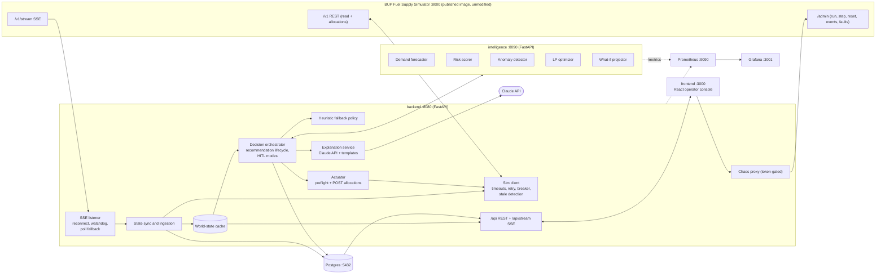
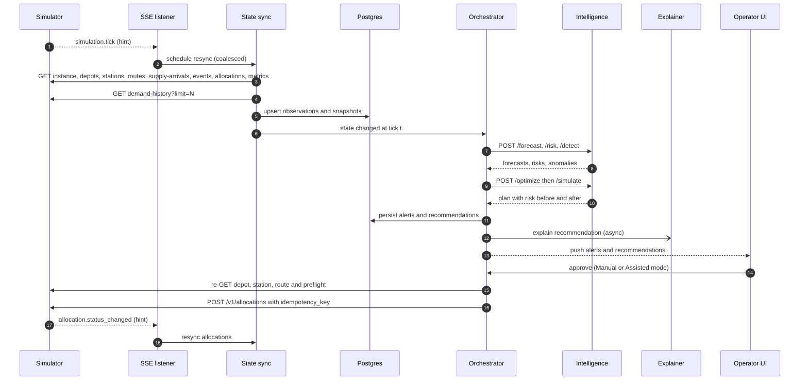
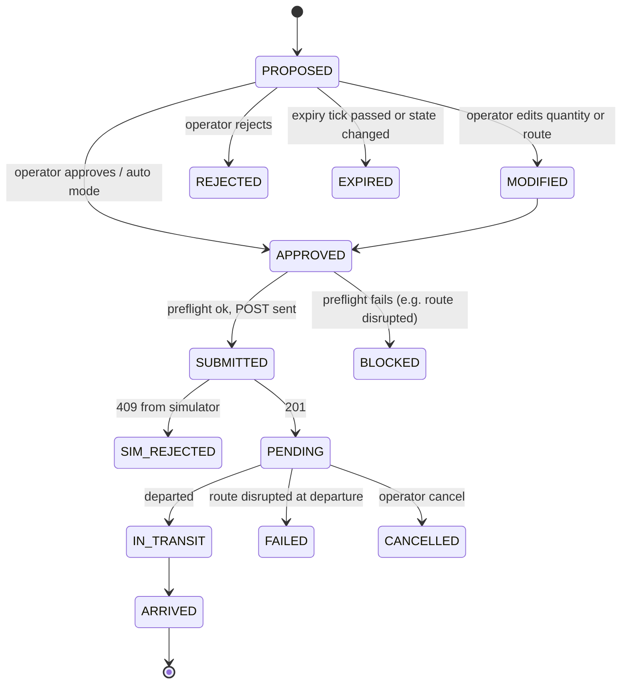

# Architecture — Fuel Supply Intelligence & Resilience Platform

> BUP CSE Fest 2026 Hackathon Finals. Source briefs: [`ProblemSet/`](ProblemSet/).
> Companion docs: [`plan.md`](plan.md) (what we build, in what order) · [`CLAUDE.md`](CLAUDE.md) (working rules).
> **All data in this system is simulated.** No real fuel infrastructure is accessed or controlled.

---

## 1. Context and goals

The organizer-provided **BUP Fuel Supply Simulator** is *the world*; our platform is *the brain*. The simulator is
deterministic, runs locally from a published image, and never predicts or recommends anything — it only executes the
allocations we submit and reports what happened.

Our platform must close the loop the brief asks for:

```
Observe → Detect → Predict → Decide → Simulate → Act → Monitor → Recover
```

**Non-negotiable integration constraints (from the integration guide):**

| # | Constraint | Consequence for our design |
|---|---|---|
| C1 | Do not modify the simulator; judges run the published image | Simulator is an external dependency behind a client/adapter |
| C2 | REST `/v1/*` is the source of truth; SSE `/v1/stream` is only a hint | Every SSE event triggers a re-GET; state is never built from SSE payloads alone |
| C3 | `POST /v1/allocations` (+ `/cancel`) is the only domain write | All actions funnel through one guarded "actuator" component |
| C4 | `/v1/*` (except `/v1/health`) is subject to injected faults | Timeouts, retries, circuit breaker, cached state, degraded mode |
| C5 | SSE has no replay, a 200-event per-subscriber buffer, 15 s keepalives | Reconnect + full REST resync; watchdog; polling fallback |
| C6 | `demand-history` is capped at 2000 rows per call (12 rows/tick) | We mirror history into our own Postgres every tick |
| C7 | World is deterministic (same seed + actions + events ⇒ same state) | Enables reproducible tests, replays and policy benchmarks via `/admin/step` |

---

## 2. System overview



Layer mapping (brief deliverable #6: *simulator → data/backend → intelligence → decision → application → monitoring*):

| Layer | Components |
|---|---|
| Simulator | `simulator` container (unmodified) |
| Data / backend | Sim client, SSE listener, state sync, world-state cache, Postgres |
| Intelligence | `intelligence` service: forecaster, risk scorer, anomaly detector |
| Decision | LP optimizer + what-if (intelligence), orchestrator, heuristic fallback, actuator, explanation service |
| Application | `/api` + React operator console |
| Monitoring | Prometheus metrics, structured logs, Grafana dashboards + alert rules, `/api/health` board |

---

## 3. Services (docker-compose)

| Service | Image / build | Port | Health check | Notes |
|---|---|---|---|---|
| `simulator` | `asifmahmoud414/bup-fuel-supply-simulator:1.0.0` | 8000 | `GET /v1/health` | Env: `SIMULATION_SPEED`, `TICK_MINUTES`, `SIMULATOR_START_MODE` |
| `backend` | `./backend` | 8080 | `GET /api/health/live` | Integration, state, orchestration, API, explanations |
| `intelligence` | `./intelligence` | 8090 | `GET /health` | Stateless per request; loads versioned model artifacts from `./models` volume |
| `frontend` | `./frontend` (Vite build → nginx) | 3000 | `GET /` | Talks only to `backend` |
| `postgres` | `postgres:16-alpine` | 5432 | `pg_isready` | Named volume; Alembic migrations run on backend start |
| `prometheus` | `prom/prometheus` | 9090 | `/-/healthy` | Scrapes backend + intelligence; loads alert rules from `infra/prometheus/` |
| `grafana` | `grafana/grafana` | 3001 | `/api/health` | Datasources + dashboards provisioned from `infra/grafana/` |
| `loki` + `promtail` *(optional)* | grafana images | 3100 | — | Only if time allows; JSON stdout logs are enough otherwise |
| `locust` *(profile `loadtest`)* | `./loadtest` | 8089 | — | Not started by default |

`depends_on: condition: service_healthy` orders startup (postgres → simulator → intelligence → backend → frontend).
Everything is configured through `.env` (see `.env.example`); no secrets are baked into images.

---

## 4. Backend (`backend/`)

Python 3.11, FastAPI, pydantic v2, httpx (async), SQLAlchemy 2 (async, asyncpg), Alembic, structlog,
prometheus-client, tenacity, anthropic SDK.

Suggested package layout:

```
backend/app/
  main.py                 # app factory, lifespan starts background tasks
  config.py               # pydantic-settings, all env vars
  integration/
    sim_client.py         # typed client for every /v1 endpoint
    sim_models.py         # pydantic models mirroring the simulator schemas
    sim_errors.py         # error-envelope parsing + 409 code enum
    breaker.py            # circuit breaker
    sse_listener.py       # /v1/stream consumer
  state/
    sync.py               # tick-driven resync + demand-history ingestion
    cache.py              # in-memory world state + freshness flags
    runs.py               # reset detection, run epochs
  decision/
    orchestrator.py       # decision cycle, modes, recommendation lifecycle
    heuristic.py          # fallback policy (also the baseline)
    preflight.py          # client-side replica of the simulator's validation order
    actuator.py           # the only code path that POSTs allocations
    intelligence_client.py
  explain/
    llm.py                # Claude API calls (async, timeout, cache)
    templates.py          # deterministic fallback explanations
  api/                    # routers: state, stations, risks, alerts, incidents,
                          # recommendations, decisions, supply, health, chaos, stream
  db/                     # models, repositories, alembic/
  observability/          # metrics registry, logging config, request middleware
```

### 4.1 Sim client (`integration/sim_client.py`)

- One `httpx.AsyncClient`, base URL from `SIM_BASE_URL`, connect/read timeouts (default 2 s / 5 s).
- **Retries** on 503 / timeouts / connection errors: exponential backoff with full jitter (tenacity), max 3 attempts
  for GETs. POST `/v1/allocations` is retried with the **same idempotency key** (safe by contract).
- **Circuit breaker** per endpoint group (reads, writes): CLOSED → OPEN after N consecutive failures in a window →
  HALF_OPEN probe after a cooldown. The breaker state is exported as a metric and shown on the health board.
- **Error envelopes** — parse all three shapes:
  - `{"detail": {"code": "...", "message": "..."}}` — domain errors (404/409)
  - `{"error": {"code": "FAULT_INJECTED", "message": "..."}}` — injected faults (503)
  - `{"detail": [...]}` — FastAPI/pydantic 422
  - `stream_disconnect` 503 uses `{"detail": {"code": "FAULT_INJECTED"}}` (nested under `detail`).
- **Stale data**: if a GET response carries `X-Simulator-Stale: true`, the resource is stored but marked
  `stale=true`; the cache freshness flag propagates to the UI banner and blocks automatic actions.
- **Response validation**: every payload is parsed into pydantic models. Invalid payload ⇒ reject, keep last-good
  state, raise a `SIM_INVALID_RESPONSE` system alert (brief §11: *invalid simulator response → reject input + raise alert*).
- **Liveness vs usability**: `/v1/health` bypasses faults, so it tells us the simulator process is alive;
  the breaker state tells us whether `/v1/*` is usable. The health board shows both.

### 4.2 SSE listener (`integration/sse_listener.py`)

- Consumes `GET /v1/stream`; ignores comment lines (`: connected`, `: keepalive`).
- Events handled: `simulation.tick`, `allocation.status_changed`, `inventory.updated`, `simulator.notice`.
  Payloads are **hints only** — each one schedules a (coalesced) REST resync.
- **Reconnect** with exponential backoff (cap 10 s). On every (re)connect ⇒ full REST resync (no Last-Event-ID replay).
- **Watchdog**: if the instance is `RUNNING` and no `simulation.tick` arrives within
  `max(3 × expected_tick_interval, 20 s)`, assume we were silently dropped (200-event queue overflow) and reconnect.
  A 15 s silence alone is *not* a disconnect (keepalive interval).
- **Polling fallback**: while the stream is unavailable (e.g. `stream_disconnect` fault ⇒ 503), poll
  `GET /v1/instance` every `POLL_INTERVAL_MS` and resync when `tick` advances. Mode is exported as a metric.
- The consumer never does heavy work inline — it pushes into an internal asyncio queue so it cannot fall behind.

### 4.3 State sync and ingestion (`state/`)

On each new tick (coalesced; at most one sync in flight):

1. `GET /v1/instance`, `/v1/depots`, `/v1/stations`, `/v1/routes`, `/v1/supply-arrivals`, `/v1/events`,
   `/v1/allocations`, `/v1/metrics` (parallel, each individually fault-tolerant).
2. `GET /v1/demand-history?limit=N` with `N = min(2000, 12 × ticks_since_last_sync + 24)`; upsert by simulator row id.
3. Diff against the previous snapshot ⇒ emit domain changes (status transitions, supply delays, quantity changes,
   new/started/resolved events) to the orchestrator and to the UI stream.
4. Persist snapshots (inventory, metrics, status changes) to Postgres. If Postgres is down, keep serving from memory
   and buffer writes in a bounded queue; health shows `database: degraded`.

**Run epochs / reset detection**: `POST /admin/reset` wipes the simulator. We detect it via `simulator.notice`
("Simulation reset") or `tick` going backwards, then open a new `sim_run` row. All persisted data is keyed by `run_id`,
and idempotency keys include the run id, so keys never collide across resets.

**UI reads never fan out to the simulator.** The API serves the cache/DB, which protects the simulator under load
and makes dashboard latency predictable (important for load testing).

### 4.4 Decision orchestrator (`decision/orchestrator.py`)

Per-tick data flow, end to end:



Decision cycle (triggered after a sync; single-flight; cadence `DECISION_EVERY_N_TICKS`, default 1):

```
1. Snapshot state (reject cycle if state is stale or older than 1 tick)
2. intelligence /forecast   → per (station, fuel) demand forecast + σ
3. intelligence /risk       → inventory position, time-to-stockout, P(stockout)
4. intelligence /detect     → anomalies (demand, inventory, supply, network)
5. Alerts/incidents         → create/update/resolve
6. intelligence /optimize   → candidate allocation plan (+ binding constraints, alternatives)
7. intelligence /simulate   → projected risk before → after for the plan
8. Recommendations          → persist as PROPOSED with rationale, confidence, expiry
9. Mode gate                → auto-approve or wait for operator
10. Actuator                → fresh re-GET + preflight → POST /v1/allocations
11. Explanation (async)     → Claude or template; never blocks steps 1–10
```

If the intelligence service is unreachable, times out (default 1.5 s), or its breaker is open, steps 2–7 are served by
the **heuristic fallback** (`decision/heuristic.py`) using an in-process seasonal-naive forecast. Recommendations are
tagged `policy=heuristic` and the `fuelops_fallback_activations_total` counter increments.

### 4.5 Recommendation lifecycle and human-in-the-loop



**Operating modes** (switchable in the UI, token-protected):

| Mode | Behaviour |
|---|---|
| **Manual** | Every recommendation waits for operator approval |
| **Assisted** *(default)* | Auto-approve when confidence ≥ `AUTO_APPROVE_MIN_CONFIDENCE`, quantity ≤ `AUTO_APPROVE_MAX_LITERS`, data is fresh and no active incident touches the entity; otherwise require review |
| **Auto** | Auto-approve everything that passes preflight (used for benchmarks and fast simulation speeds) |

This satisfies the guardrail *"preserve human review for consequential simulated decisions"* and brief §11
*"prediction confidence too low → human review requested"*.

### 4.6 Actuator, preflight and idempotency (`decision/actuator.py`, `preflight.py`)

- The actuator is the **only** code that calls `POST /v1/allocations` or `/cancel`.
- Before each POST: re-GET the depot, station and route, then run **preflight** — the simulator's validation order
  replicated client-side: ids exist → route matches (depot, station) → depot status ∈ {OPEN, CONSTRAINED} → station
  OPEN → route AVAILABLE → `quantity ≤ max_shipment` → depot inventory ≥ quantity → dispatch capacity this tick →
  station headroom. Preflight failures never reach the simulator.
- **Idempotency key** = `fo-{run_id}-{recommendation_id}-{part}` (≤ 150 chars, deterministic, unique per intended
  shipment). Retries reuse the key. A new decision always gets a new key (cancellation does not free keys).
- Shipments larger than `max_shipment` are split into `part`s.
- Responses: `201` and `200` are both treated as success (the guide contradicts itself on idempotent replays).

**409 handling map:**

| Code | Automatic reaction |
|---|---|
| `IDEMPOTENCY_KEY_MISMATCH` | Bug signal: alert, never retry with the same key |
| `ROUTE_MISMATCH` / `NOT_FOUND` | Bug or stale topology: resync topology, alert |
| `DEPOT_CLOSED` | Mark depot unusable, re-optimize from other depot |
| `STATION_CLOSED` | Drop recommendation; station outage incident |
| `ROUTE_DISRUPTED` | Re-optimize with the route excluded (cross-region reroute) |
| `ROUTE_CAPACITY_EXCEEDED` | Split into parts ≤ `max_shipment` |
| `INSUFFICIENT_INVENTORY` | Resync depot, reduce quantity or wait for next supply arrival |
| `DISPATCH_CAPACITY_EXCEEDED` | Defer remainder to next tick |
| `DESTINATION_CAPACITY_EXCEEDED` | Reduce to available headroom |
| `CANNOT_CANCEL` | Shipment already moving; record and continue |

### 4.7 Explanation service (`explain/`)

- Uses the **Claude API** via the official `anthropic` SDK. Model from `LLM_MODEL` (default `claude-opus-5-5`),
  key from `ANTHROPIC_API_KEY`. Hard timeout (`LLM_TIMEOUT_S`, default 8 s), cached per recommendation/incident.
- Uses: (a) human-readable explanation per recommendation, (b) incident summary when an incident opens/changes,
  (c) on-demand "network briefing" (state summarization), (d) operator investigation Q&A grounded in the current state
  JSON (not a free chatbot — answers cite entities, numbers and alerts from our state).
- Prompts receive **only structured facts** we computed (risk numbers, binding constraints, alternatives,
  confidence). The LLM explains; it never decides or changes numbers.
- **Fallback**: deterministic templates render the same facts when there is no key, on timeout, or on error
  (`explanation_source = template | llm`, exported as a metric). The decision loop never waits on the LLM.

---

## 5. Intelligence service (`intelligence/`)

Python 3.11, FastAPI, pandas/numpy, LightGBM, scikit-learn, OR-Tools (GLOP LP). Stateless per request: the backend
sends the current state and a recent demand window (last 96 ticks); the service loads a versioned model artifact at
startup. `GET /model/info` reports the model version, training data range and validation metrics.

| Endpoint | Input | Output |
|---|---|---|
| `POST /forecast` | recent window, stations (+ `demand_multiplier`), horizon ticks | per (station, fuel, tick): mean, σ |
| `POST /risk` | state (on-hand, in-transit, capacity), forecasts | inventory position, time-to-stockout (h), P(stockout) per horizon |
| `POST /detect` | recent window, forecasts, state diff | anomalies with type, severity, evidence |
| `POST /optimize` | state, forecasts, risks, policy params | allocation plan, objective, binding constraints, alternatives |
| `POST /simulate` | state, forecasts, plan | projected inventory + risk before → after (what-if) |

### 5.1 Demand forecasting

The simulator's demand is structured (spec §8.5–8.6): daily base per (profile, fuel) × region `demand_factor` ×
hour-of-day factor × station `demand_multiplier` (changed by `demand_spike` events) × noise (8–12%).

- **Primary model**: seasonal baseline (per station/fuel hour-of-day profile learned from history) × live
  `demand_multiplier`, plus a LightGBM model on the residual (features: hour, day index, profile, fuel, region,
  multiplier, lags 1/4/96, rolling means). Output mean + σ from recent residual spread.
- **Fallback**: seasonal-naive (same hour yesterday × multiplier ratio) — also embedded in the backend heuristic.
- **Evaluation**: every forecast is stored; when actuals arrive we compute MAE/MAPE per horizon (exported metrics,
  shown in the UI) — "prediction error" observability.
- **Training**: `intelligence/train.py` reads mirrored history from Postgres, writes
  `models/forecast-<version>.pkl` + `models/forecast-<version>.json` (metrics, data range, features) — lightweight
  experiment tracking and model versioning. `MODEL_VERSION` env selects the artifact (rollback = previous version).

### 5.2 Risk scoring

- **Inventory position** `IP = on_hand + in_transit_to_station` (in-transit from our allocation ledger; the
  simulator's capacity check ignores in-transit, we must not).
- **Time-to-stockout**: walk the hourly forecast until cumulative demand exceeds `IP`, including scheduled arrivals.
- **P(stockout within H)** ≈ `1 − Φ((IP − μ_H) / σ_H)` with μ_H, σ_H the horizon demand mean/σ (Monte Carlo
  optional). Horizons: next 4 h, 12 h, 24 h.
- **Confidence** combines recent forecast MAPE for the series, data freshness (stale flag), history length and
  whether a regime change (active event) is in progress.

### 5.3 Detection

| Detector | Signal |
|---|---|
| Demand anomaly | Residual z-score > 3 or CUSUM breach, per series; ≥ 2 stations in one region ⇒ *emerging regional disruption* |
| Inventory anomaly | Observed Δinventory ≠ expected (−served + arrivals) beyond tolerance |
| Supply risk | Arrival status → `DELAYED`, `planned_tick` moved, or `quantity` below first-seen value (shortfall) |
| Network change | Route `DISRUPTED`, station `OUTAGE`, depot `CONSTRAINED` transitions |
| Pre-emptive | Events visible as `SCHEDULED` in `/v1/events` ⇒ pre-position stock before `start_tick` |
| Bottleneck | Dispatch capacity utilisation > 90 % for consecutive ticks; single-route stations at risk |

### 5.4 Allocation optimizer (LP)

Decision variables `q[r,f] ≥ 0` (liters on available route `r`, fuel `f`, this cycle); shortfall slack `u[s,f] ≥ 0`.

```
minimize    Σ_s,f  w[s,f] · u[s,f]  +  Σ_r,f  c[r] · q[r,f]  +  Σ_d,f  ρ · below_reserve[d,f]

subject to  u[s,f] ≥ T[s,f] − IP[s,f] − Σ_{r→s} q[r,f]                      (target coverage)
            Σ_{r→s} q[r,f] ≤ cap[s,f] − IP[s,f]                            (station headroom incl. in-transit)
            Σ_{r from d} q[r,f] ≤ inv[d,f]                                  (depot inventory, hard)
            Σ_{r from d} q[r,f] ≤ inv[d,f] − reserve[d,f] + below_reserve[d,f]
                                                                            (soft reserve, net of upcoming supply)
            Σ_{r from d, f} q[r,f] ≤ dispatch_cap[d] − dispatched_this_tick[d]
            q[r,f] ≤ k · max_shipment[r]                                    (split into ≤ k parts)
            q[r,·] = 0 if route DISRUPTED, station not OPEN, or depot closed
```

- `T[s,f]` (order-up-to target) = forecast demand over `transit_ticks + cover_window` + `z·σ` safety stock, capped
  at capacity.
- `w[s,f]` = urgency weight from P(stockout) and time-to-stockout (fair rationing when supply is scarce).
- `c[r]` ∝ `transit_ticks` (+ cross-region penalty) so direct 2-tick routes are preferred; cross-region 4-tick
  routes (`gazipur→karnaphuli`, `patiya→mirpur`) are used when needed for reroutes.
- Post-processing: round to 100 L, drop parts < `MIN_SHIPMENT_L`, split by `max_shipment`.
- The solver returns **binding constraints** and **alternatives** (e.g. the next-best route, or "wait for supply at
  tick N") — these feed the recommendation card and the explanation.

### 5.5 Heuristic fallback (also the baseline)

Greedy order-up-to: rank (station, fuel) by time-to-stockout; for each, pick the shortest AVAILABLE route from a depot
with stock and dispatch headroom; ship `min(T − IP, headroom, max_shipment, depot stock − reserve)`. Deterministic,
dependency-free, runs in the backend process.

### 5.6 What-if projector

Rolls the state forward tick by tick with forecast demand, scheduled supply arrivals and plan arrivals
(`departure = next tick`, `arrival = departure + transit_ticks`), producing projected inventory curves and
P(stockout) before vs. after (e.g. *"Stockout risk 72 % → 19 %"*). Also powers operator-edited plans ("modify" in UI).

*(Optional stretch: an RL policy trained offline against the deterministic simulator using `/admin/reset` + `/admin/step`,
benchmarked against the heuristic and LP — see `plan.md` §Benchmark.)*

---

## 6. Data model (Postgres)

| Table | Purpose |
|---|---|
| `sim_runs` | One row per simulator run epoch (seed, scenario, started/reset times) |
| `demand_observations` | Mirror of `/v1/demand-history` (unique on run + simulator row id) |
| `inventory_snapshots` | Per tick, per entity/fuel inventory + capacity |
| `status_changes` | Route/station/depot/supply status transitions |
| `sim_metrics` | Per-tick copy of `/v1/metrics` (service level timeline) |
| `forecasts` | Forecast mean/σ per target tick + model version; error filled when actual arrives |
| `alerts` | Shortage, anomaly, supply, network and system alerts (severity, status, ack) |
| `incidents` | Correlated alerts/events with timeline, LLM/template summary |
| `recommendations` | Plan lines with rationale JSON, risk before/after, confidence, policy, status, expiry |
| `decisions` | Audit trail: who/what approved/rejected/modified, when (wall + tick), reason |
| `allocations` | Our ledger joined to simulator allocations (idempotency key, status, failure reason) |
| `app_audit_log` | Operator actions (mode changes, chaos injections, cancellations) |

Migrations with Alembic; repositories isolate SQL from domain logic.

---

## 7. Backend API (for the operator console)

| Method + path | Purpose |
|---|---|
| `GET /api/health`, `/api/health/live` | Component board (backend, DB, simulator liveness, simulator API breaker, SSE mode, intelligence, decision engine, LLM, p95 latency, error rate) / liveness |
| `GET /api/state` | Current world snapshot + freshness flags (stale, degraded, sse_mode) |
| `GET /api/stations/{id}`, `/api/depots/{id}` | Detail incl. forecast, risk, recent history |
| `GET /api/risks` | Ranked (station, fuel) risk table |
| `GET /api/alerts`, `POST /api/alerts/{id}/ack` | Alert feed |
| `GET /api/incidents`, `GET /api/incidents/{id}` | Incidents with summary and timeline |
| `GET /api/recommendations`, `POST /api/recommendations/compute` | List / trigger a decision cycle |
| `POST /api/recommendations/{id}/approve \| reject \| modify \| simulate` | HITL actions + what-if |
| `POST /api/allocations/{id}/cancel` | Cancel a PENDING allocation |
| `GET /api/decisions` | Decision history (audit) |
| `GET /api/supply`, `GET /api/allocations` | Incoming supply, shipment ledger |
| `GET/PUT /api/settings/mode` | Manual / Assisted / Auto |
| `POST /api/briefing`, `POST /api/ask` | LLM network briefing / grounded investigation Q&A |
| `GET /api/stream` | SSE to the UI (state changed, alerts, recommendations, health) |
| `POST /api/chaos/{events,faults,faults/clear,run,pause,step,reset}` | Token-gated proxy to `/admin/*` for demos |
| `GET /metrics` | Prometheus |

Mutating endpoints require `Authorization: Bearer <OPERATOR_TOKEN>`. The OpenAPI schema is the contract; the frontend
generates TypeScript types from it (`openapi-typescript`).

---

## 8. Frontend (`frontend/`)

React 18 + Vite + TypeScript (strict), TanStack Query (REST cache), EventSource for `/api/stream` (invalidates
queries), React Router, Tailwind + shadcn/ui, Recharts. Pages:

1. **Network overview** — schematic of 2 depots → 6 routes → 4 stations, colored by status; per-fuel inventory gauges;
   service level; active incidents; `SIMULATED DATA` badge; stale/degraded banners.
2. **Station / depot detail** — inventory vs capacity, forecast with uncertainty band vs actuals, time-to-stockout,
   P(stockout), incoming shipments and supply.
3. **Alerts & incidents** — feed with severity, evidence and LLM/template summary.
4. **Recommendations** — inspector card (why at risk, signals, binding constraints, expected impact before → after,
   confidence, alternatives, explanation) with Approve / Modify (what-if) / Reject; mode switch.
5. **Supply & shipments** — supply-arrival schedule (delays highlighted), allocation ledger, cancel PENDING.
6. **Decision history** — audit trail with filters.
7. **System health** — component board, breaker states, SSE mode, p95 / error rate, fallback activations, links to
   Grafana.
8. **Chaos panel** — inject crisis events / faults, run / pause / step / reset (demo + self-test).

---

## 9. Resilience design

| Failure | Detection | Response | Recovery |
|---|---|---|---|
| Intelligence service down / slow | Timeout, breaker OPEN, health probe | Heuristic fallback policy; recs tagged `heuristic` | Breaker HALF_OPEN probe → CLOSED; resume LP |
| Simulator `unavailable` / `error_rate` (503) | Error envelope, breaker | Retry w/ backoff + jitter; serve cached state flagged `degraded`; pause auto-actions | Breaker closes; full resync |
| Simulator `latency` | Client timeouts, latency histogram | Timeouts + retries; skip decision cycle if state too old | Automatic |
| `stale_data` | `X-Simulator-Stale` header | Banner; block auto-approval; recs require review | Header disappears ⇒ resync |
| `stream_disconnect` / silent drop | 503 on connect / watchdog | Poll `/v1/instance`; reconnect loop | Stream back ⇒ full resync |
| Invalid simulator response | pydantic validation failure | Reject payload, keep last-good state, system alert | Next valid response |
| Low prediction confidence | Confidence < threshold | Human review required (even in Assisted mode) | — |
| Allocation rejected (409) | Error code | Code-specific reaction (§4.6) | — |
| Postgres down | Health check / write errors | In-memory state continues; bounded write buffer; DB `degraded` | Flush buffer |
| LLM down / no key | Timeout / error | Template explanations | Automatic |
| Backend crash | Container health check | `restart: unless-stopped`; state rebuilt from REST + DB on start | Automatic |
| Simulator reset | `simulator.notice` / tick regression | New run epoch; clear caches | Automatic |

Techniques used: timeouts, retries with jitter, circuit breakers, idempotent writes, cached last-good state,
graceful degradation, fallback policy, health checks, restart policies, and image-tag rollback.

---

## 10. Observability

**Metrics** (prefix `fuelops_`):

| Layer | Metrics |
|---|---|
| Application | `http_requests_total{route,method,status}`, `http_request_duration_seconds` (histogram → p50/p95/p99), availability |
| Simulator integration | `sim_requests_total{endpoint,outcome}`, `sim_request_duration_seconds`, `sim_breaker_state`, `sim_stale`, `sse_connected`, `sse_mode{stream,polling}`, `sse_reconnects_total`, `tick_lag` (sim tick − processed tick) |
| Intelligence | `forecast_mae`, `forecast_mape{horizon}`, `recommendation_confidence`, `shortage_alerts_total`, `decision_cycles_total`, `decision_cycle_duration_seconds`, `fallback_activations_total`, `llm_requests_total{outcome}`, `llm_latency_seconds` |
| Business | `service_level`, `unmet_demand_liters`, `allocation_failures`, `stations_at_risk`, `recommendations_total{status}` |
| System | Container CPU/memory via cAdvisor (optional) or Docker stats in the load-test report |

**Logs**: structlog JSON to stdout with `run_id`, `tick`, `request_id`, `recommendation_id`. Key events:
`decision.proposed/approved/submitted/rejected`, `integration.failure`, `breaker.state_changed`, `fallback.activated`,
`incident.opened/resolved`, `recovery.completed`.

**Dashboards** (provisioned JSON in `infra/grafana/`): *Operations* (service level, unmet demand, stations at risk,
alerts), *Platform* (latency, error rate, breaker/SSE state, tick lag), *Intelligence* (forecast error, confidence,
fallback activations, LLM health).

**Alert rules** (`infra/prometheus/alerts.yml`): `SimulatorApiDegraded`, `SseDisconnected`, `IntelligenceDown`,
`FallbackActive`, `HighApiErrorRate`, `HighP95Latency`, `ServiceLevelDrop`, `StockoutRiskHigh`, `TickLagHigh`.
Firing alerts are also surfaced on the UI health page.

---

## 11. Deployment and CI/CD

- **Run**: `cp .env.example .env && docker compose up -d` → UI http://localhost:3000, API :8080/docs,
  Grafana :3001, simulator dashboard :8000/admin.
- **Pipeline** (GitHub Actions, `.github/workflows/ci.yml`):

```
lint (ruff, eslint, tsc) → unit tests (pytest, vitest) → integration tests
(simulator image as a service container: pause → reset → allocate → step N → assert)
→ build images → push to GHCR (:sha, :latest on main) → compose smoke test (health checks) → publish report
```

- **Versioning & rollback**: images tagged with the git SHA; `IMAGE_TAG` in `.env` selects the version,
  `docker compose up -d` rolls forward/back. Model artifacts are versioned by `MODEL_VERSION`; decision policy can be
  switched LP ↔ heuristic at runtime (policy rollback).
- **Optional**: Kubernetes manifests / Helm chart (`infra/k8s/`) only if time allows and it adds demo value.

---

## 12. Security and hygiene

- No secrets in code or images; `.env` is gitignored, `.env.example` documents every variable; CI uses GitHub secrets.
- All external input (simulator payloads, API requests) validated with pydantic.
- Mutating operator actions and the chaos proxy require `OPERATOR_TOKEN`; chaos proxy can be disabled
  (`CHAOS_ENABLED=false`).
- CORS restricted to the frontend origin. LLM prompts contain only simulated operational data.
- UI and API responses clearly label data as simulated.

---

## 13. Architecture decision records (short)

| ADR | Decision | Why |
|---|---|---|
| 001 | Python/FastAPI backend + React/Vite/TS frontend | Python fits ML/optimization and matches the simulator's ecosystem; React gives a real-time operator console |
| 002 | Separate `intelligence` service | Clear failure boundary → demonstrable "ML unavailable → fallback" behaviour; independent model versioning |
| 003 | LP optimizer + greedy heuristic fallback | LP is explainable (binding constraints) and fast (< 50 ms); heuristic guarantees decisions when ML is down and doubles as benchmark baseline |
| 004 | Postgres (no TSDB) | Data volume is small (12 rows/tick); one familiar store for history, audit and recommendations |
| 005 | Claude API for explanations with template fallback | Adds human-readable reasoning and incident summaries without putting an LLM on the critical decision path |
| 006 | Serve UI from cache, never proxy reads to simulator | Predictable latency under load, protects simulator, works in degraded mode |
| 007 | Deterministic idempotency keys `fo-{run}-{rec}-{part}` | Safe retries, no collisions across resets or regenerated recommendations |
