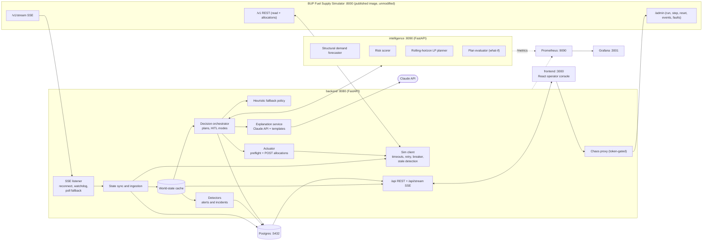
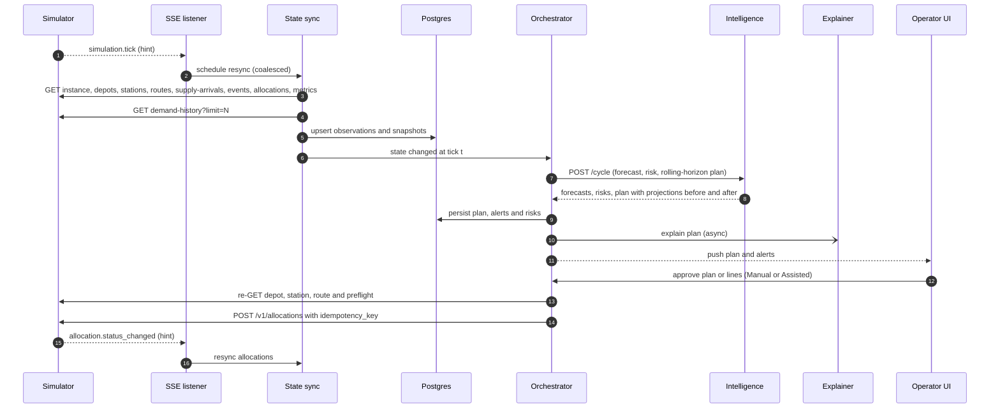
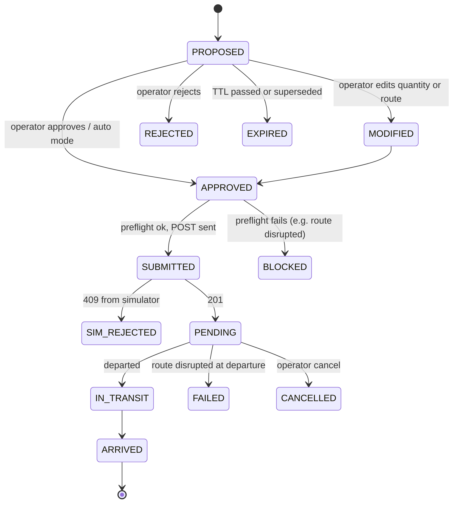

# Architecture — Fuel Supply Intelligence & Resilience Platform

> BUP CSE Fest 2026 Hackathon Finals. Source briefs: [`ProblemSet/`](ProblemSet/).
> Companion docs: [`plan.md`](plan.md) (what we build, in what order) · [`plan.json`](plan.json) (tracker) ·
> [`CLAUDE.md`](CLAUDE.md) (working rules).
> **All data in this system is simulated.** No real fuel infrastructure is accessed or controlled.
> Scope is sized for a **≤ 24 h build by 2–3 people** — see ADRs in §13 for what was cut and why.

---

## 1. Context and goals

The organizer-provided **BUP Fuel Supply Simulator** is *the world*; our platform is *the brain*. The simulator is
deterministic, runs locally from a published image, and never predicts or recommends anything — it only executes the
allocations we submit and reports what happened.

Our platform must close the loop the brief asks for:

```
Observe → Detect → Predict → Decide → Simulate → Act → Monitor → Recover
```

**Non-negotiable integration constraints (from the integration guide):**

| # | Constraint | Consequence for our design |
|---|---|---|
| C1 | Do not modify the simulator; judges run the published image | Simulator is an external dependency behind a client/adapter |
| C2 | REST `/v1/*` is the source of truth; SSE `/v1/stream` is only a hint | Every SSE event triggers a re-GET; state is never built from SSE payloads alone |
| C3 | `POST /v1/allocations` (+ `/cancel`) is the only domain write | All actions funnel through one guarded "actuator" component |
| C4 | `/v1/*` (except `/v1/health`) is subject to injected faults | Timeouts, retries, circuit breaker, cached state, degraded mode |
| C5 | SSE has no replay, a 200-event per-subscriber buffer, 15 s keepalives | Reconnect + full REST resync; watchdog; polling fallback |
| C6 | `demand-history` is capped at 2000 rows per call (12 rows/tick) | We mirror history into our own Postgres every tick |
| C7 | World is deterministic (same seed + actions + events ⇒ same state) | Enables reproducible tests, replays and policy benchmarks via `/admin/step` |

**What actually makes decisions good in this world** (drives the intelligence design):

- Demand is *structured*: base × region factor × hour-of-day factor × station `demand_multiplier` × per-tick jitter.
  The multiplier is readable on `/v1/stations`, and crisis events are listed in `/v1/events` (as `SCHEDULED` before
  they start). Once the structure is modelled, what remains is jitter — the forecast error floor.
- The hard part is **timing under constraints**: 2–4 tick transit, per-tick depot dispatch caps, station capacity,
  single-route stations (Tongi, Cox's Bazar), and disruptions announced in advance. That calls for a
  **rolling-horizon optimizer** whose objective is the judged metric (minimize unmet liters ⇒ maximize `service_level`).

---

## 2. System overview



Layer mapping (brief deliverable #6: *simulator → data/backend → intelligence → decision → application → monitoring*):

| Layer | Components |
|---|---|
| Simulator | `simulator` container (unmodified) |
| Data / backend | Sim client, SSE listener, state sync, world-state cache, Postgres |
| Intelligence | `intelligence` service: forecaster, risk scorer; backend detectors |
| Decision | Rolling-horizon planner + evaluator (intelligence), orchestrator, heuristic fallback, actuator, explanations |
| Application | `/api` + React operator console |
| Monitoring | Prometheus metrics, structured logs, Grafana dashboard + alert rules, `/api/health` board |

---

## 3. Services (docker-compose)

`backend` and `intelligence` are **one Python project and one image** (`server/`), started with different commands.
That keeps one dependency set, one Dockerfile and shared models, while still giving a real process boundary for the
"ML unavailable → fallback" demonstration.

| Service | Image / build | Port | Health check | Notes |
|---|---|---|---|---|
| `simulator` | `asifmahmoud414/bup-fuel-supply-simulator:1.0.0` | 8000 | `GET /v1/health` | Env: `SIMULATION_SPEED`, `TICK_MINUTES`, `SIMULATOR_START_MODE` |
| `backend` | `./server` → `uvicorn fuelops.backend.main:app` | 8080 | `GET /api/health/live` | Integration, state, detectors, orchestration, API, explanations |
| `intelligence` | `./server` → `uvicorn fuelops.intelligence.main:app` | 8090 | `GET /health` | Stateless per request; forecast params from `./models` volume |
| `frontend` | `./frontend` (Vite build → nginx) | 3000 | `GET /` | Talks only to `backend` |
| `postgres` | `postgres:16-alpine` | 5432 | `pg_isready` | Named volume; tables created at backend start (`create_all`, no migrations) |
| `prometheus` | `prom/prometheus` | 9090 | `/-/healthy` | Scrapes backend + intelligence; alert rules from `infra/prometheus/` |
| `grafana` | `grafana/grafana` | 3001 | `/api/health` | One provisioned dashboard from `infra/grafana/` |
| `locust` *(profile `loadtest`)* | `./loadtest` | 8089 | — | Not started by default |

`depends_on: condition: service_healthy` orders startup; `restart: unless-stopped` on our services. Everything is
configured through `.env` (see `.env.example`); no secrets are baked into images.

---

## 4. Backend (`server/fuelops/backend/`)

Python 3.11, FastAPI, pydantic v2, httpx (async), SQLAlchemy 2 (async, asyncpg), structlog, prometheus-client,
tenacity, anthropic SDK.

```
server/
  pyproject.toml, Dockerfile
  fuelops/
    shared/                 # config (pydantic-settings), logging, metrics helpers, domain models
                            # (WorldState, Forecast, Plan) exchanged between backend and intelligence
    backend/
      main.py               # app factory; lifespan starts sync loop, SSE listener, decision loop
      integration/          # sim_client, sim_models, sim_errors, breaker, sse_listener
      state/                # sync, cache, runs (reset detection), db (SQLAlchemy models)
      alerts/               # detectors, incidents
      decision/             # orchestrator, plans (lifecycle), heuristic, preflight, actuator, intelligence_client
      explain/              # llm, templates
      api/                  # routers: state, plans, alerts, supply, health, chaos, stream
    intelligence/
      main.py
      forecast.py           # structural model
      risk.py
      planner.py            # rolling-horizon LP (OR-Tools GLOP)
      evaluate.py           # projection / what-if
  tests/
```

### 4.1 Sim client (`integration/sim_client.py`)

- One `httpx.AsyncClient`, base URL from `SIM_BASE_URL`, connect/read timeouts (default 2 s / 5 s).
- **Retries** on 503 / timeouts / connection errors: exponential backoff with full jitter (tenacity), max 3 attempts
  for GETs. POST `/v1/allocations` is retried with the **same idempotency key** (safe by contract).
- **Circuit breaker** per endpoint group (reads, writes): CLOSED → OPEN after N consecutive failures → HALF_OPEN probe
  after a cooldown. State is exported as a metric and shown on the health board.
- **Error envelopes** — parse all shapes:
  - `{"detail": {"code": "...", "message": "..."}}` — domain errors (404/409)
  - `{"error": {"code": "FAULT_INJECTED", "message": "..."}}` — injected faults (503)
  - `{"detail": [...]}` — FastAPI/pydantic 422
  - `stream_disconnect` 503 uses `{"detail": {"code": "FAULT_INJECTED"}}` (nested under `detail`).
- **Stale data**: a GET with `X-Simulator-Stale: true` is stored but flagged `stale`; the flag propagates to the UI
  banner and blocks automatic approval.
- **Response validation**: every payload is parsed into pydantic models. Invalid payload ⇒ reject, keep last-good
  state, raise a `SIM_INVALID_RESPONSE` system alert (brief §11).
- **Liveness vs usability**: `/v1/health` bypasses faults (process alive); the breaker says whether `/v1/*` is usable.
  The health board shows both.

### 4.2 SSE listener (`integration/sse_listener.py`)

- Consumes `GET /v1/stream`; ignores comment lines (`: connected`, `: keepalive`).
- Events: `simulation.tick`, `allocation.status_changed`, `inventory.updated`, `simulator.notice` — **hints only**;
  each schedules a coalesced REST resync.
- **Reconnect** with exponential backoff (cap 10 s); every (re)connect ⇒ full resync (no replay).
- **Watchdog**: if RUNNING and no `simulation.tick` within `max(3 × expected_tick_interval, 20 s)`, assume a silent
  drop (200-event overflow) and reconnect. A 15 s silence alone is normal (keepalive).
- **Polling fallback**: while the stream is unavailable, poll `GET /v1/instance` every `POLL_INTERVAL_MS` and resync
  when `tick` advances. The walking skeleton (I1) starts with polling only; SSE is added in I3.
- The consumer only enqueues; it never does heavy work inline, so it cannot fall behind.

### 4.3 State sync and ingestion (`state/`)

On each new tick (coalesced; one sync in flight):

1. `GET /v1/instance`, `/v1/depots`, `/v1/stations`, `/v1/routes`, `/v1/supply-arrivals`, `/v1/events`,
   `/v1/allocations`, `/v1/metrics` (parallel, individually fault-tolerant).
2. `GET /v1/demand-history?limit=N`, `N = min(2000, 12 × ticks_since_last_sync + 24)`; upsert by simulator row id.
3. Diff against the previous snapshot ⇒ domain changes (status transitions, supply delays/shortfalls, event
   lifecycle) to the detectors, orchestrator and UI stream.
4. Persist snapshots (inventory, station `demand_multiplier`, metrics, status changes). If Postgres is down, keep
   serving from memory and mark `database: degraded` (write-buffer replay is optional).

**Run epochs / reset detection**: `simulator.notice` ("Simulation reset") or `tick` going backwards opens a new
`sim_run`; all persisted data and idempotency keys include the `run_id`.

**UI reads never fan out to the simulator** — the API serves cache/DB, protecting the simulator and keeping dashboard
latency predictable under load.

### 4.4 Detectors (`alerts/`)

Detectors live in the backend so alerts keep working when the intelligence service is down.

| Detector | Signal |
|---|---|
| Scheduled / active events | New `SCHEDULED` or `ACTIVE` event in `/v1/events` ⇒ pre-emptive alert with affected entities |
| Network change | Route `DISRUPTED`, station `OUTAGE`, depot `CONSTRAINED`; single-route station at risk ⇒ "no alternative route" |
| Supply risk | Arrival → `DELAYED`, `planned_tick` moved, or `quantity` below first-seen value |
| Demand anomaly | Residual vs latest forecast, z-score > 3 for consecutive ticks; ≥ 2 stations in one region ⇒ *emerging regional disruption*; flags spikes the multiplier does not explain |
| Inventory anomaly | Observed Δinventory ≠ −served + arrivals − dispatches beyond tolerance |
| Shortage | Time-to-stockout below threshold or P(stockout) above threshold (from risk scores) |

Related alerts are correlated into **incidents** (by entity, region and event id) with a timeline and summary.

### 4.5 Decision orchestrator and plans (`decision/`)

Per-tick data flow, end to end:



Decision cycle (after each sync; single-flight; cadence `DECISION_EVERY_N_TICKS`, default 1):

```
1. Snapshot state (skip cycle if state is stale or older than 1 tick)
2. intelligence POST /cycle → forecasts (μ, σ), risks, plan for this tick + projections with/without plan
3. Persist a PLAN (one per cycle) with its lines, rationale, confidence, expiry
4. Mode gate → auto-approve or wait for the operator
5. Actuator → fresh re-GET + preflight → POST /v1/allocations
6. Explanation (async) → Claude or template; never blocks steps 1–5
```

If intelligence is unreachable, times out (`INTELLIGENCE_TIMEOUT_S`, default 1.5 s) or its breaker is open, the
backend uses the **heuristic fallback** with an in-process seasonal-naive forecast; plans are tagged
`policy=heuristic` and `fuelops_fallback_activations_total` increments. `PLANNER_POLICY=heuristic` forces the
fallback (policy rollback).

**Plans, not a stream of single recommendations.** At simulation speed an operator cannot review one recommendation
per tick, so each cycle produces one plan (all shipments for this tick). The operator approves the plan or single
lines; a plan not acted on expires after `PLAN_TTL_TICKS` (default 2) and is superseded by the next cycle.



(States apply per plan line; a plan's state summarises its lines.)

**Operating modes** (UI switch, token-protected):

| Mode | Behaviour |
|---|---|
| **Manual** | Every plan waits for operator approval |
| **Assisted** *(default)* | Auto-approve lines when confidence ≥ `AUTO_APPROVE_MIN_CONFIDENCE`, quantity ≤ `AUTO_APPROVE_MAX_LITERS`, data is fresh and no open incident touches the entity; everything else waits for review (management by exception) |
| **Auto** | Auto-approve every line that passes preflight (benchmarks, high simulation speeds) |

This satisfies the guardrail *"preserve human review for consequential simulated decisions"* and brief §11
*"prediction confidence too low → human review requested"*.

### 4.6 Actuator, preflight and idempotency (`decision/actuator.py`, `preflight.py`)

- The actuator is the **only** code that calls `POST /v1/allocations` or `/cancel`.
- Before each POST: re-GET depot, station and route; run **preflight** in the simulator's validation order: ids exist
  → route matches (depot, station) → depot status ∈ {OPEN, CONSTRAINED} → station OPEN → route AVAILABLE →
  `quantity ≤ max_shipment` → depot inventory ≥ quantity → dispatch capacity this tick → station headroom.
- **Idempotency key** = `fo-{run_id}-{plan_id}-{line}-{part}` (≤ 150 chars, deterministic, unique per intended
  shipment). Retries reuse the key; a new decision always gets a new key (cancellation does not free keys).
- Lines larger than `max_shipment` are split into `part`s. `201` and `200` both mean success on replay.

**409 handling map:**

| Code | Automatic reaction |
|---|---|
| `IDEMPOTENCY_KEY_MISMATCH` | Bug signal: alert, never retry with the same key |
| `ROUTE_MISMATCH` / `NOT_FOUND` | Bug or stale topology: resync topology, alert |
| `DEPOT_CLOSED` | Mark depot unusable, re-plan |
| `STATION_CLOSED` | Drop line; station outage incident |
| `ROUTE_DISRUPTED` | Re-plan with the route excluded (cross-region reroute) |
| `ROUTE_CAPACITY_EXCEEDED` | Split into parts ≤ `max_shipment` |
| `INSUFFICIENT_INVENTORY` | Resync depot, reduce quantity or wait for next supply arrival |
| `DISPATCH_CAPACITY_EXCEEDED` | Defer remainder to next tick |
| `DESTINATION_CAPACITY_EXCEEDED` | Reduce to available headroom |
| `CANNOT_CANCEL` | Shipment already moving; record and continue |

### 4.7 Explanation service (`explain/`)

- **Claude API** via the `anthropic` SDK; model from `LLM_MODEL` (default `claude-opus-5-5`; a faster model such as
  `claude-sonnet-5-5` or `claude-haiku-4-5-20251001` is a config change), key from `ANTHROPIC_API_KEY`.
  Hard timeout (`LLM_TIMEOUT_S`, default 8 s), cached per plan/incident.
- Uses: (a) plan explanation, (b) incident summary, (c) on-demand network briefing. Operator Q&A is optional.
- Prompts receive **only structured facts** we computed (risks, binding constraints, alternatives, confidence,
  projections). The LLM explains; it never decides or changes numbers.
- **Fallback**: deterministic templates render the same facts when there is no key, on timeout, or on error
  (`explanation_source = template | llm`, exported as a metric).

---

## 5. Intelligence service (`server/fuelops/intelligence/`)

pandas/numpy, OR-Tools (GLOP LP). Stateless per request: the backend sends the world state, scheduled/active events
and a recent demand window (last 96 ticks); forecast parameters are loaded from a versioned JSON file at startup.
`GET /model/info` reports model version, fit window and validation metrics.

| Endpoint | Input | Output |
|---|---|---|
| `POST /cycle` | state, events, recent window, policy params | forecasts, risks, plan for this tick, projections with/without plan, binding constraints, alternatives |
| `POST /evaluate` | state, events, forecasts, a fixed plan (e.g. operator edit) | projected inventory, unmet liters and risk for that plan (what-if) |
| `POST /forecast` | recent window, stations, horizon | per (station, fuel, tick): μ, σ (also used by the load test) |

### 5.1 Structural demand forecast

```
μ[s,f,t] = b[s,f,hour(t)] × m[s](t)          σ[s,f,t] = k[s,f] × μ[s,f,t]
```

- `b` — per station, fuel and hour-of-day demand level, learned from mirrored history as the mean of
  `demand / demand_multiplier` in that hour bucket. It starts from a **spec prior** (profile base / 96 × region
  factor × hour factor, §8.5–8.6 of the guide) and shifts to the data as observations accumulate. The guide's example
  row (≈ 95 L at 03:00 for Mirpur diesel) does not match a naive spec calculation (≈ 62 L), so the data wins;
  the spike (Q-09) confirms the mapping.
- `m` — current station `demand_multiplier`; scheduled `demand_spike` events are applied inside their window.
- `k` — relative jitter, estimated from residuals (spec noise 8–12 %). If residuals turn out autocorrelated, add an
  AR(1) correction; otherwise jitter is the irreducible error floor.
- Forecasts are stored; MAE/MAPE per horizon are computed when actuals arrive and compared with the noise floor.
- Parameters are saved as `models/forecast-<version>.json` with metrics — lightweight model versioning and
  experiment tracking. A LightGBM residual model is an optional comparison only (ADR-008).

### 5.2 Risk scoring

- **Inventory position** = on-hand + in-transit to the station (the simulator's capacity check ignores in-transit;
  we must not).
- **Time-to-stockout** from the projected inventory trajectory (forecast demand, scheduled supply and in-transit
  arrivals).
- **P(stockout within H)** ≈ `1 − Φ((IP_H − μ_H) / σ_H)` for H = 4 h, 12 h, 24 h, with cumulative μ and σ.
- **Supply ETA**: expected arrival tick per supply arrival (planned tick, `DELAYED` status, anticipated
  `shipment_delay` events) and per shipment (created + 1 + transit).
- **Confidence** combines recent forecast error for the series, data freshness, history length and whether an event
  is changing the regime.

### 5.3 Rolling-horizon LP planner (`planner.py`)

Plan `H = PLAN_HORIZON_TICKS` ticks ahead (default 24 = 6 h), execute only the shipments for the current tick, and
re-plan every tick (model-predictive control). Shipment lag `ℓ_r = 1 + transit_ticks_r` (created at t, departs t+1,
arrives t+1+transit — confirmed by Q-03).

Variables (t = 0..H−1): shipments `x[r,f,t] ≥ 0`, station inventory `I[s,f,t]`, unmet demand `u[s,f,t] ≥ 0`, depot
inventory `J[d,f,t]`, terminal shortfall `v[s,f] ≥ 0`.

```
minimize   Σ_t Σ_s,f (1 + ρ[s,f])·u[s,f,t]  +  Σ_t Σ_r,f c[r]·x[r,f,t]  +  β·Σ_s,f v[s,f]

subject to I[s,f,t] = I[s,f,t−1] + A[s,f,t] + Σ_{r→s} x[r,f,t−ℓ_r] − D̂[s,f,t] + u[s,f,t]   (station balance)
           0 ≤ I[s,f,t] ≤ cap[s,f]          0 ≤ u[s,f,t] ≤ D̂[s,f,t]
           I[s,f,t−1] + Σ_{r→s} x[r,f,t] ≤ cap[s,f]                                  (simulator's creation-time check)
           J[d,f,t] = J[d,f,t−1] + S[d,f,t] − Σ_{r from d} x[r,f,t] ,   J[d,f,t] ≥ 0     (depot balance)
           Σ_{r from d, f} x[r,f,t] ≤ dispatch_cap[d] − committed[d,t]                   (dispatch cap)
           x[r,f,t] ≤ k_max · max_shipment[r]                                             (split into parts)
           x[r,·,t] = 0 when route r is DISRUPTED at t, its station is not OPEN, or its depot is closed
           v[s,f] ≥ SS[s,f] − I[s,f,H−1]                                                  (terminal safety stock)
```

- `D̂ = μ + z·σ` (`PLAN_SAFETY_Z`, default 1) — plans against an upper demand quantile to absorb jitter.
- `A` = arrivals of shipments already in transit; `S` = scheduled supply arrivals (with anticipated delays/shortfalls).
- **Scheduled events are applied to the parameters inside their windows**: demand spikes raise `D̂`, route
  disruptions zero the route, outages close the station, supply delays shift `S`. This is what lets the planner
  pre-position stock at single-route stations *before* a disruption starts.
- Objective weight 1 on unmet liters aligns the plan with the judged `service_level`; `c[r]` (∝ transit ticks,
  cross-region penalty) is small and only breaks ties; `ρ` are optional priority weights (default 0).
- Size ≈ 1,100 variables at H = 24; GLOP solves in milliseconds.
- **Outputs**: shipments for t = 0 (rounded to 100 L, parts < `MIN_SHIPMENT_L` dropped, split by `max_shipment`),
  full projected trajectories, **binding constraints** (e.g. "Gazipur dispatch cap binding at t=0,1"), unavoidable
  shortfall (rationing), and **alternatives** (re-solve with the chosen route excluded, or "wait until supply at
  tick N").

### 5.4 Plan evaluator (what-if)

The same projection model with `x` fixed: *no action*, *the proposed plan*, or *an operator-edited plan*. It returns
projected unmet liters, stockout ticks and P(stockout) — the "risk before → after" on every plan
(e.g. *"Mirpur petrol stockout risk 72 % → 19 %"*).

### 5.5 Heuristic fallback (also the baseline)

Greedy order-up-to, in the backend process: rank (station, fuel) by time-to-stockout; for each, pick the shortest
AVAILABLE route from a depot with stock and dispatch headroom; ship
`min(target − IP, headroom, max_shipment, depot stock − reserve)`. Deterministic and dependency-free.

*(Optional, only if time remains: an RL policy trained offline via `/admin/reset` + `/admin/step`, compared with the
heuristic and the planner in the benchmark.)*

---

## 6. Data model (Postgres)

Tables are created at startup from SQLAlchemy models (no migration tool — ADR-009).

| Table | Purpose |
|---|---|
| `sim_runs` | One row per simulator run epoch (seed, scenario, started/reset times) |
| `demand_observations` | Mirror of `/v1/demand-history` (unique on run + simulator row id) |
| `snapshots` | Per tick, per entity/fuel inventory, capacity, station `demand_multiplier`, statuses |
| `sim_metrics` | Per-tick copy of `/v1/metrics` (service level timeline) |
| `forecasts` | μ/σ per target tick + model version; error filled when the actual arrives |
| `alerts`, `incidents` | Detector output, correlation, summaries |
| `plans`, `plan_lines` | Per-cycle plans with rationale JSON, projections, confidence, policy, status, expiry |
| `decisions` | Audit trail: who/what approved/rejected/modified, when (wall + tick), reason |
| `allocations` | Our ledger joined to simulator allocations (idempotency key, status, failure reason) |
| `app_audit_log` | Operator actions (mode changes, chaos injections, cancellations) |

---

## 7. Backend API (for the operator console)

| Method + path | Purpose |
|---|---|
| `GET /api/health`, `/api/health/live` | Component board (backend, DB, simulator liveness, simulator API breaker, SSE mode, intelligence, decision engine, LLM, p95 latency, error rate) / liveness |
| `GET /api/state` | Current world snapshot + freshness flags (stale, degraded, sse_mode) |
| `GET /api/stations/{id}` | Detail incl. forecast band, projected inventory, risk |
| `GET /api/risks` | Ranked (station, fuel) risk table |
| `GET /api/alerts`, `POST /api/alerts/{id}/ack`, `GET /api/incidents[/{id}]` | Alerts and incidents |
| `GET /api/plans`, `GET /api/plans/{id}` | Current and past plans with lines, rationale, projections |
| `POST /api/plans/{id}/approve \| reject`, `POST /api/plans/{id}/lines/{n}/approve \| reject \| modify` | HITL actions |
| `POST /api/plans/{id}/evaluate` | What-if for an edited plan |
| `GET /api/decisions` | Decision history (audit) |
| `GET /api/supply`, `GET /api/allocations`, `POST /api/allocations/{id}/cancel` | Supply schedule, shipment ledger, cancel PENDING |
| `GET/PUT /api/settings/mode` | Manual / Assisted / Auto |
| `POST /api/briefing` | LLM network briefing |
| `GET /api/stream` | SSE to the UI (state changed, alerts, plans, health) |
| `POST /api/chaos/{events,faults,faults/clear,run,pause,step,reset}` | Token-gated proxy to `/admin/*` for demos |
| `GET /metrics` | Prometheus |

Mutating endpoints require `Authorization: Bearer <OPERATOR_TOKEN>`.

---

## 8. Frontend (`frontend/`)

React + Vite + TypeScript (strict), TanStack Query, EventSource on `/api/stream`, Tailwind, Recharts.
Five views (quality over quantity):

1. **Overview** — schematic of 2 depots → 6 routes → 4 stations colored by status; per-fuel inventory gauges;
   regional demand; service level; incoming-supply strip; open incidents; `SIMULATED DATA` badge;
   stale / degraded / fallback banners. Clicking a station opens a drawer: forecast band vs actuals, projected
   inventory with and without the plan, time-to-stockout, P(stockout).
2. **Plans** — current plan: per line why at risk, signals, binding constraints, impact before → after, confidence,
   alternatives, explanation; approve / modify (what-if) / reject; mode switch; decision-history tab.
3. **Alerts & incidents** — feed with severity, evidence, timeline and summary.
4. **Supply & shipments** — supply-arrival schedule (delays highlighted), allocation ledger, cancel PENDING.
5. **Health** — component board, breaker states, SSE mode, p95 / error rate, fallback activations, Grafana link;
   **chaos drawer** (token-gated) to inject events/faults and run / pause / step / reset.

---

## 9. Resilience design

| Failure | Detection | Response | Recovery |
|---|---|---|---|
| Intelligence service down / slow | Timeout, breaker OPEN | Heuristic fallback; plans tagged `heuristic` | Breaker HALF_OPEN probe → CLOSED; planner resumes |
| Simulator `unavailable` / `error_rate` (503) | Error envelope, breaker | Retry w/ backoff + jitter; cached state flagged `degraded`; auto-approval paused | Breaker closes; full resync |
| Simulator `latency` | Client timeouts, latency histogram | Timeouts + retries; skip decision cycle if state too old | Automatic |
| `stale_data` | `X-Simulator-Stale` header | Banner; auto-approval blocked; plans need review | Header gone ⇒ resync |
| `stream_disconnect` / silent drop | 503 on connect / watchdog | Poll `/v1/instance`; reconnect loop | Stream back ⇒ full resync |
| Invalid simulator response | pydantic validation failure | Reject payload, keep last-good state, system alert | Next valid response |
| Low prediction confidence | Confidence < threshold | Human review required, even in Assisted mode | — |
| Allocation rejected (409) | Error code | Code-specific reaction (§4.6) | — |
| Postgres down | Health check / write errors | In-memory state continues; DB shown `degraded` | Writes resume |
| LLM down / no key | Timeout / error | Template explanations | Automatic |
| Backend crash | Container health check | `restart: unless-stopped`; state rebuilt from REST + DB | Automatic |
| Simulator reset | `simulator.notice` / tick regression | New run epoch; caches cleared | Automatic |

---

## 10. Observability

**Metrics** (prefix `fuelops_`):

| Layer | Metrics |
|---|---|
| Application | `http_requests_total{route,method,status}`, `http_request_duration_seconds` (p50/p95/p99), availability |
| Simulator integration | `sim_requests_total{endpoint,outcome}`, `sim_request_duration_seconds`, `sim_breaker_state`, `sim_stale`, `sse_connected`, `sse_mode{stream,polling}`, `sse_reconnects_total`, `tick_lag` |
| Intelligence | `forecast_mae`, `forecast_mape{horizon}`, `plan_confidence`, `shortage_alerts_total`, `decision_cycles_total`, `decision_cycle_duration_seconds`, `planner_solve_seconds`, `fallback_activations_total`, `llm_requests_total{outcome}`, `llm_latency_seconds` |
| Business | `service_level`, `unmet_demand_liters`, `allocation_failures`, `stations_at_risk`, `plan_lines_total{status}` |
| System | Container CPU/memory captured with `docker stats` during load tests (cAdvisor optional) |

**Logs**: structlog JSON to stdout with `run_id`, `tick`, `request_id`, `plan_id`. Key events:
`decision.proposed/approved/submitted/rejected`, `integration.failure`, `breaker.state_changed`,
`fallback.activated`, `incident.opened/resolved`, `recovery.completed`.

**Dashboard**: one provisioned Grafana dashboard with three rows — *Operations* (service level, unmet demand,
stations at risk, alerts), *Platform* (latency, error rate, breaker/SSE state, tick lag), *Intelligence* (forecast
error vs noise floor, confidence, fallback activations, LLM health).

**Alert rules** (`infra/prometheus/alerts.yml`): `SimulatorApiDegraded`, `IntelligenceDown`, `SseDisconnected`,
`HighP95Latency`, `ServiceLevelDrop`. Firing alerts also show on the UI Health view.

---

## 11. Deployment and CI/CD

- **Run**: `cp .env.example .env && docker compose up -d` → UI http://localhost:3000, API :8080/docs,
  Grafana :3001, simulator console :8000/admin.
- **Pipeline** (GitHub Actions, `.github/workflows/ci.yml`):

```
lint (ruff, eslint, tsc) → unit tests (pytest, vitest) → integration tests
(simulator image as a service container: pause → reset → allocate → step N → assert) → docker build
→ [should] push to GHCR (:sha, :latest on main) → [should] compose smoke test (health checks)
```

- **Versioning & rollback**: images tagged with the git SHA (`IMAGE_TAG`) when pushed to GHCR, otherwise git tags +
  `docker compose build`; forecast params versioned by `MODEL_VERSION`; decision policy switchable planner ↔
  heuristic at runtime (`PLANNER_POLICY`, UI toggle).

---

## 12. Security and hygiene

- No secrets in code or images; `.env` is gitignored, `.env.example` documents every variable; CI uses GitHub secrets.
- All external input (simulator payloads, API requests) validated with pydantic.
- Mutating operator actions and the chaos proxy require `OPERATOR_TOKEN`; chaos proxy can be disabled
  (`CHAOS_ENABLED=false`).
- CORS restricted to the frontend origin. LLM prompts contain only simulated operational data.
- UI and API clearly label data as simulated.

---

## 13. Architecture decision records (short)

| ADR | Decision | Why |
|---|---|---|
| 001 | Python/FastAPI + React/Vite/TS | Python fits optimization/ML and the simulator's ecosystem; React gives a real-time operator console |
| 002 | Separate `intelligence` process | Real failure boundary ⇒ demonstrable "ML unavailable → fallback"; independent model versioning |
| 003 | **Rolling-horizon LP planner** + greedy heuristic fallback | Handles transit lags, per-tick dispatch caps and scheduled disruptions; objective = judged service level; explainable via binding constraints; what-if reuses the same model. Heuristic guarantees decisions when ML is down and is the benchmark baseline |
| 004 | Postgres (no TSDB) | Small volume (12 rows/tick); one store for history, audit and plans; can be stopped to demo degradation |
| 005 | Claude API for explanations with template fallback | Human-readable reasoning without putting an LLM on the decision path |
| 006 | Serve UI from cache, never proxy reads to the simulator | Predictable latency under load, protects simulator, works in degraded mode |
| 007 | Deterministic idempotency keys `fo-{run}-{plan}-{line}-{part}` | Safe retries, no collisions across resets or regenerated plans |
| 008 | **Structural forecast, not LightGBM** | Demand structure is known and the multiplier/events are observable; the remainder is seeded jitter, so a learned structural model reaches the noise floor. LightGBM stays an optional comparison |
| 009 | **One Python project/image for backend + intelligence; `create_all` instead of migrations; detectors in backend** | ≤ 24 h build with 2–3 people: one dependency set and Dockerfile, shared models; alerts keep working when intelligence is down |
| 010 | Plans per cycle with batch approval | Operators cannot review one recommendation per tick at simulation speed; Assisted mode = management by exception |
